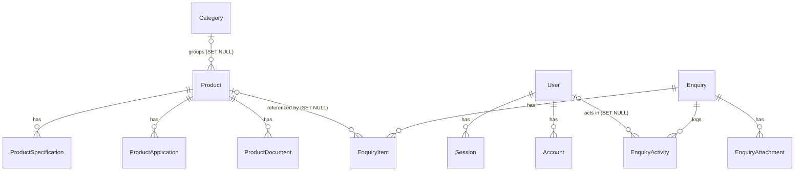

# Database Design

PostgreSQL 16 (Docker for development), accessed through Prisma 7 with the `@prisma/adapter-pg` driver adapter. The schema is `prisma/schema.prisma`; the SQL that actually runs is in `prisma/migrations/`. This document describes the schema as built in sub-project 2 (data layer, catalogue and RFQ).

Conventions that apply to every table:

- Primary key `id`: a UUID generated by the database (`gen_random_uuid()`), never by the application.
- `createdAt` (default `now()`) and `updatedAt` (maintained by Prisma) on every table.
- Table names are lowercase snake_case through `@@map` (`product_document`, `enquiry_item` ...), matching the tables Better Auth expects. Column names keep Prisma's camelCase (`"casNormalized"`), so raw SQL must quote them.
- Timestamps are `timestamp(3)` without time zone, holding UTC (Prisma's default).

## Entity overview



`Verification`, `SiteSetting` and `RateLimitHit` stand alone (no foreign keys).

## Enums

| Enum | Values | Notes |
|---|---|---|
| `Role` | `SUPER_ADMIN`, `ADMINISTRATOR`, `SALES_MANAGER`, `SALES_EXECUTIVE`, `CONTENT_EDITOR`, `HR_MANAGER` | Only `SUPER_ADMIN` and `SALES_MANAGER` may use the admin in this sub-project (`src/lib/access.ts`). New users default to `CONTENT_EDITOR`, the least privileged, so no sign-up path can create an admin |
| `ProductStatus` | `DRAFT`, `PUBLISHED`, `ARCHIVED` | Only `PUBLISHED` is ever shown publicly |
| `EnquiryType` | `FRAGRANCES`, `AROMA_CHEMICALS`, `FLAVOURS`, `GENERAL`, `CAREERS` | `CAREERS` is reserved for the careers sub-project |
| `EnquiryStatus` | `NEW`, `ASSIGNED`, `CONTACTED`, `QUOTATION_SENT`, `NEGOTIATION`, `WON`, `LOST` | Changed in the admin; every change writes an activity row |
| `DocumentKind` | `DATASHEET`, `SDS`, `OTHER` | |
| `Unit` | `KG`, `G`, `MT`, `L`, `ML`, `OTHER` | The RFQ form has no default unit: the visitor must choose one |

## Entities

### Auth (Better Auth 1.7.18)

Generated with the Better Auth CLI for the Prisma adapter, then hand-edited: `role` uses the `Role` enum (default `CONTENT_EDITOR`), and id defaults are spelled `gen_random_uuid()` so Prisma reports no drift.

| Model (table) | Purpose | Keys and indexes |
|---|---|---|
| `User` (`user`) | Admin accounts: `name`, `email`, `emailVerified`, `image`, `role` | `email` unique |
| `Session` (`session`) | Signed-in sessions: `token`, `expiresAt`, `ipAddress`, `userAgent` | `token` unique; index on `userId` |
| `Account` (`account`) | Credentials per provider; the email/password hash lives in `password` | index on `userId` |
| `Verification` (`verification`) | Better Auth verification tokens | index on `identifier` |

### Catalogue

| Model (table) | Purpose | Keys and indexes |
|---|---|---|
| `Category` (`category`) | `name`, `slug`, `sortOrder` | `slug` unique |
| `Product` (`product`) | `name`, `slug`, `code`, `casNumber`, `casNormalized`, `description`, `status`, `publishedAt`, `seoTitle`, `seoDescription`, `sourceNote` (provenance, internal only), `verified` | `slug` unique; `code` unique (optional); btree indexes on `casNormalized`, `status`, `categoryId`; trigram GIN indexes on `name` and `code` |
| `ProductSpecification` (`product_specification`) | `label`, `value`, `sortOrder` | index on `productId` |
| `ProductApplication` (`product_application`) | `name` | index on `productId` |
| `ProductDocument` (`product_document`) | `kind`, `title`, `mimeType`, `storageKey` (private storage location) | `storageKey` unique; index on `productId` |

### Enquiries

| Model (table) | Purpose | Keys and indexes |
|---|---|---|
| `Enquiry` (`enquiry`) | One RFQ submission: `reference` (e.g. `AQ-2026-000123`), `submissionId`, `type`, `status`, contact fields (`fullName`, `companyName`, `email`, `phone`, `country`, `businessSegment`), `intendedApplication`, `additionalRequirements`, `consentAt`, `ipHash` (salted hash, never the raw IP), `userAgent` | `reference` unique; `submissionId` unique (optional); indexes on (`status`, `createdAt`), `type`, `createdAt` |
| `EnquiryItem` (`enquiry_item`) | One product line: `productId` (optional), `productNameSnapshot`, `casSnapshot`, `quantity` (`decimal(14,3)`), `unit`, `notes` | indexes on `enquiryId`, `productId` |
| `EnquiryAttachment` (`enquiry_attachment`) | `filename` (sanitised), `mimeType`, `sizeBytes`, `storageKey` (random) | `storageKey` unique; index on `enquiryId` |
| `EnquiryActivity` (`enquiry_activity`) | Append-only log: `action` (`enquiry.created`, `status.changed`, `attachment.downloaded`, `email.sent`, `email.failed`, `email.skipped`, `notification.skipped`), `detail` (JSON), `actorId` (null for system/visitor actions) | indexes on (`enquiryId`, `createdAt`), `actorId` |

### System

| Model (table) | Purpose | Keys and indexes |
|---|---|---|
| `SiteSetting` (`site_setting`) | Key/value JSON settings, e.g. `notification.recipients.AROMA_CHEMICALS` | `key` unique |
| `RateLimitHit` (`rate_limit_hit`) | Fixed-window counters: `key`, `windowStart`, `count` | (`key`, `windowStart`) unique; index on `windowStart` |

## Indexes

All indexes are declared in the schema, so Prisma never treats them as drift.

- **Trigram search:** `product_name_trgm_idx` and `product_code_trgm_idx` are `GIN (... gin_trgm_ops)` indexes. They need the `pg_trgm` extension, which the first migration creates (`CREATE EXTENSION IF NOT EXISTS pg_trgm`). They serve the catalogue's substring search on name and code.
- **CAS search:** `casNormalized` holds the CAS number as digits only, so `64-17-5`, `64175` and ` 64-17-5 ` all hit the btree index on `product_casNormalized_idx`. It is a plain index, not unique (see the rationale below).
- **Unique indexes:** `product.slug`, `product.code`, `product_document.storageKey`, `category.slug`, `enquiry.reference`, `enquiry.submissionId`, `enquiry_attachment.storageKey`, `site_setting.key`, `rate_limit_hit (key, windowStart)`, `user.email`, `session.token`.
- **Optional unique columns:** `product.code` and `enquiry.submissionId` may be NULL. There are no partial indexes: Postgres allows any number of NULLs in a unique index, so "unique when set" needs nothing more.
- **List and filter indexes:** `product.status`, `product.categoryId`, `enquiry (status, createdAt)`, `enquiry.type`, `enquiry.createdAt`, `rate_limit_hit.windowStart`, plus an index on every foreign key column.

## Constraints

- **Publishing rule (CHECK):** `product_published_requires_verified`, hand-written in the first migration:

  ```sql
  CHECK ("status" <> 'PUBLISHED' OR ("verified" AND "name" <> '' AND "slug" <> ''))
  ```

  A product can only be `PUBLISHED` when it is verified and has a non-empty name and slug. The admin checks the same thing first so it can show a clear message (`src/features/products/publish-guard.ts`), but the database is the final guard: no code path, script or race can publish an unverified product.
- **Unique `reference`:** enquiry references never collide (allocation is described below).
- **Unique `submissionId`:** the RFQ form sends one random UUID per form instance. A replayed or double-clicked submission hits the unique index, and the server returns the existing enquiry's reference instead of storing a second one or sending a second email.
- **Unique (`key`, `windowStart`) on `RateLimitHit`:** one counter row per key and window. Increments are a single `INSERT ... ON CONFLICT DO UPDATE ... RETURNING "count"` (`src/lib/rate-limit-db.ts`), so concurrent requests cannot lose a count.
- **Reserved slug:** `documents` is never assigned to a product, because `/aroma-chemicals/documents/[id]` is the document download route. This is enforced in slug assignment (`RESERVED_SLUGS` in `src/features/products/schema.ts`), not in the database.

## Delete rules

| Foreign key | On delete | Effect |
|---|---|---|
| `Session.userId`, `Account.userId` | CASCADE | Deleting a user removes their sessions and credentials |
| `EnquiryActivity.actorId` | SET NULL | Deleting a user keeps the activity rows they wrote, without an actor |
| `Product.categoryId` | SET NULL | Deleting a category leaves its products uncategorised |
| `ProductSpecification`, `ProductApplication`, `ProductDocument` `.productId` | CASCADE | Deleting a product removes its specifications, applications and document rows |
| `EnquiryItem.productId` | SET NULL | Deleting a product keeps enquiry lines readable through `productNameSnapshot` and `casSnapshot` |
| `EnquiryItem`, `EnquiryAttachment`, `EnquiryActivity` `.enquiryId` | CASCADE | Deleting an enquiry removes its lines, attachment rows and activity log |

Caveats:

- `EnquiryActivity` is append-only by convention (the application only inserts), but it is **not** protected against an enquiry being deleted: the cascade removes the log with the enquiry. Nothing in the application deletes enquiries today.
- A cascade removes database rows only. The files behind `ProductDocument.storageKey` and `EnquiryAttachment.storageKey` stay in storage and must be removed separately.
- All foreign keys use `ON UPDATE CASCADE` (Prisma's default). Ids are never updated.

## Rationale for key decisions

- **UUID primary keys.** Ids appear in URLs (`/admin/enquiries/<id>`, `/api/admin/attachments/<id>`, `/aroma-chemicals/documents/<id>`) and must not be guessable or reveal volumes. Better Auth is configured with `generateId: "uuid"` so every table is consistent. The human-facing number is the separate `reference`.
- **`casNormalized` is indexed but not unique.** The legacy data has duplicate and conflicting CAS numbers (Iso Bornyl Propionate and Hydratropic Alcohol were both shown with 1123-85-9; see `docs/content-verification.md` A5 to A8). A unique index would block importing the catalogue as drafts. Conflicting rows are imported with CAS left empty and a `sourceNote`, and identity is settled by the client during verification.
- **Snapshot fields on `EnquiryItem`.** `productNameSnapshot` and `casSnapshot` record what the buyer actually asked for at submission time. Products can later be renamed, corrected, unpublished or deleted (`productId` is then SET NULL) without changing the meaning of an old enquiry. Free-text lines (products not in the catalogue) have no `productId` at all.
- **Rate-limit counters in Postgres, not Redis.** The RFQ limiter (5 per hour per IP hash, 100 per hour shared fallback) and the per-recipient acknowledgement cap (3 per day) need a store shared by every server instance. Postgres is already required, the volume is low, and one atomic upsert per check is cheap. This avoids running another service. Keys are salted SHA-256 hashes (`RATE_LIMIT_SALT`), never raw IPs or email addresses. (The admin sign-in limiter is Better Auth's, kept in memory per process; see the README.)
- **References through a per-year advisory lock.** `AQ-<year>-<6 digits>` is allocated inside a transaction that first takes `pg_advisory_xact_lock(0x41510001, <year>)`, then reads the highest sequence for that year and inserts the next one (`src/features/enquiries/submit.ts`). Concurrent submissions queue on the lock instead of racing, the lock is released at commit or rollback, and the unique index on `reference` remains the final guard. A Postgres sequence was not used because it would not restart each year and leaves gaps on rollback.
- **`ipHash` and `userAgent` are stored, the raw IP is not.** They support abuse investigation without keeping the address itself. They are never shown in the admin.
- **Storage keys are random and private.** Files live outside `public/`; the database stores only the key, and downloads go through permission-checked routes that never send the key to a browser.

## Migration workflow

There are two databases on the Docker Postgres container `aquila-postgres` (created by `docker/postgres-init.sql`):

- `aquila`: development data, used by `npm run dev`, `seed:admin` and `import:products` (`DATABASE_URL`).
- `aquila_test`: used only by `npm run test:int` and `npm run test:e2e` (`DATABASE_URL_TEST`). Both suites truncate its tables.

To change the schema:

1. Edit `prisma/schema.prisma`.
2. Generate the migration without applying it:

   ```bash
   npx prisma migrate dev --create-only --name <change>
   ```

   Review the SQL and add any raw SQL Prisma cannot express (extensions, CHECK constraints).
3. Apply it to the development database:

   ```bash
   npx prisma migrate deploy
   ```

4. Nothing extra is needed for `aquila_test`: the integration and e2e global setups run `prisma migrate deploy` against it before every run.

Why not plain `prisma migrate dev`: in a non-interactive shell (CI, scripts, coding agents) it applied the migration and then hung waiting for input, and `--create-only` refuses to continue when Prisma wants a confirmation (for example when adding a unique index). In that case generate the SQL with `npx prisma migrate diff --from-config-datasource --to-schema prisma/schema.prisma --script` and save it as the new migration. `migrate deploy` and `migrate status` never prompt.

`prisma.config.ts` reads only `DATABASE_URL`. To run a Prisma command against the test database by hand, override `DATABASE_URL` for that one command.

**Test-database guard.** `tests/integration/env-guard.ts` refuses to run the integration suite unless `DATABASE_URL_TEST` is set, has a database name, and names a different database from `DATABASE_URL`. The e2e setup (`tests/e2e/support/e2e-env.ts`) additionally requires the name to end in `_test`. Every e2e database helper checks again before connecting.

Migration SQL is stored with LF line endings (`.gitattributes`: `prisma/migrations/** text eol=lf`), so checksums match on every platform.

## Known gaps

- **No audit table yet.** Product status and verification changes are recorded only as a structured server log line (`[admin.audit] {...}`, `src/features/admin/audit.ts`). Enquiry changes are recorded in `EnquiryActivity`. A database audit table is planned for the full-admin sub-project.
- **Rate-limit rows are never pruned.** Old `RateLimitHit` rows accumulate. Until a cleanup job exists, periodically delete rows whose `windowStart` is older than a day (`DELETE FROM "rate_limit_hit" WHERE "windowStart" < now() - interval '2 days'`).
- **No deletion of enquiries or users.** There is no admin feature, script or retention job for deleting enquiries, attachments or users, and retention periods are not yet set (the privacy notice says "to be confirmed by Aquila"). When this is built it must also remove the stored files and consider keeping the activity log.
- **References stop at 999,999 per year.** Allocation throws past that.
